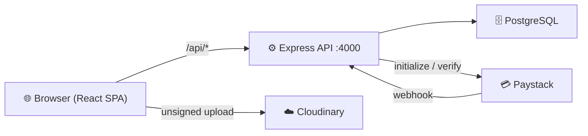
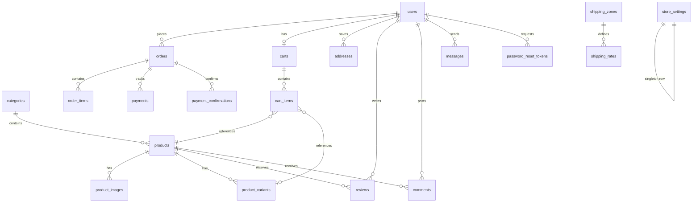
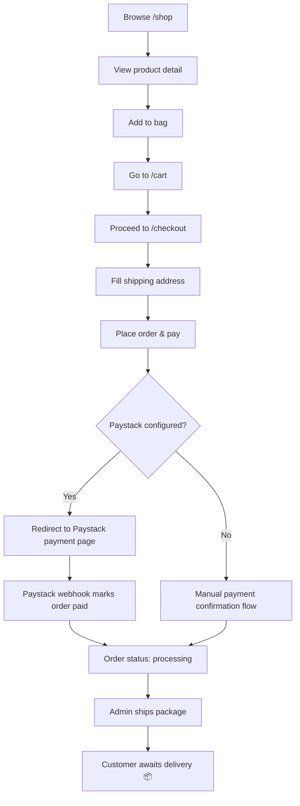

# LinaStyledYou — Project Overview

> [!NOTE]
> **LinaStyledYou** is a single-seller e-commerce web app for selling wigs and beauty products. Customers browse, add to bag, check out, pay online (Paystack), and track their orders.

---

## Tech Stack

| Layer | Technology |
|---|---|
| **Frontend** | React 19 + React Router 7 + Vite 8 |
| **Backend** | Express 4 (Node.js 20+, ES modules) |
| **Database** | PostgreSQL 15+ (with `pg_trgm` for search) |
| **Auth** | JWT (`jsonwebtoken` + `bcryptjs`) |
| **Payments** | Paystack (server-side initialize → redirect → webhook verify) |
| **Image hosting** | Cloudinary (unsigned upload preset) or manual URL |
| **Email** | Resend (for password reset) |
| **Deployment** | Docker Compose / Render Blueprint / Vercel (frontend only) |

---

## Architecture



---

## Database Schema (13 tables)



**Key tables:** `users`, `categories`, `products`, `product_variants`, `product_images`, `carts`, `cart_items`, `orders`, `order_items`, `payments`, `payment_confirmations`, `reviews`, `comments`, `messages`, `addresses`, `shipping_zones`, `shipping_rates`, `store_settings`, `password_reset_tokens`

---

## Backend Structure

| Path | Purpose |
|---|---|
| [`server.js`](file:///c:/Users/hp/Documents/ChatGPT/my%20store/backend/src/server.js) | Express app entry — CORS, Helmet, rate limiting, route mounting |
| [`config/db.js`](file:///c:/Users/hp/Documents/ChatGPT/my%20store/backend/src/config/db.js) | PostgreSQL connection pool |
| [`database/schema.sql`](file:///c:/Users/hp/Documents/ChatGPT/my%20store/backend/src/database/schema.sql) | Full DDL (13 tables + indexes) |
| [`database/migrate.js`](file:///c:/Users/hp/Documents/ChatGPT/my%20store/backend/src/database/migrate.js) | Runs schema.sql against the DB |
| [`database/seed.js`](file:///c:/Users/hp/Documents/ChatGPT/my%20store/backend/src/database/seed.js) | Sample categories & products |
| **Routes** | |
| [`routes/auth.js`](file:///c:/Users/hp/Documents/ChatGPT/my%20store/backend/src/routes/auth.js) | Register, login, `/me`, password reset |
| [`routes/catalog.js`](file:///c:/Users/hp/Documents/ChatGPT/my%20store/backend/src/routes/catalog.js) | Public product listing & search |
| [`routes/cart.js`](file:///c:/Users/hp/Documents/ChatGPT/my%20store/backend/src/routes/cart.js) | Server-side cart CRUD |
| [`routes/orders.js`](file:///c:/Users/hp/Documents/ChatGPT/my%20store/backend/src/routes/orders.js) | Place order (stock-validated), cancel, history |
| [`routes/payments.js`](file:///c:/Users/hp/Documents/ChatGPT/my%20store/backend/src/routes/payments.js) | Initialize Paystack, webhook, manual confirmation |
| [`routes/admin.js`](file:///c:/Users/hp/Documents/ChatGPT/my%20store/backend/src/routes/admin.js) | Admin dashboard: orders, users, messages, settings |
| [`routes/admin-products.js`](file:///c:/Users/hp/Documents/ChatGPT/my%20store/backend/src/routes/admin-products.js) | Admin product/variant/category CRUD |
| [`routes/support.js`](file:///c:/Users/hp/Documents/ChatGPT/my%20store/backend/src/routes/support.js) | Contact form messages |
| **Services** | |
| [`services/payment.service.js`](file:///c:/Users/hp/Documents/ChatGPT/my%20store/backend/src/services/payment.service.js) | Paystack integration (initialize, verify, webhook) |
| [`services/email.service.js`](file:///c:/Users/hp/Documents/ChatGPT/my%20store/backend/src/services/email.service.js) | Resend email for password resets |
| [`services/order-summary.js`](file:///c:/Users/hp/Documents/ChatGPT/my%20store/backend/src/services/order-summary.js) | Order total calculation |
| [`middleware/auth.js`](file:///c:/Users/hp/Documents/ChatGPT/my%20store/backend/src/middleware/auth.js) | JWT verification middleware |

---

## Frontend (Single-file SPA)

The entire storefront lives in a single [`main.jsx`](file:///c:/Users/hp/Documents/ChatGPT/my%20store/frontend/src/main.jsx) (~2000 lines) with these pages/components:

| Component | Route | What it does |
|---|---|---|
| `Home` | `/` | Hero banner, featured products, shipping message |
| `Shop` | `/shop` | Full catalog with live search |
| `Product` | `/product/:id` | Product detail, variant picker, reviews & Q&A |
| `CartPage` | `/cart` | Bag view with qty controls |
| `Checkout` | `/checkout` | Shipping form → place order → Paystack redirect |
| `Login` | `/login` | Login / register + forgot password |
| `AccountDetails` | `/account` | Profile, order history, cancel unpaid orders |
| `Contact` | `/contact` | Contact form + WhatsApp link |
| `AdminCatalog` | `/admin` | Product CRUD, Cloudinary upload, variant management |
| `Header` / `Footer` | — | Navigation, cart badge, social links |

---

## Customer Purchase Flow



---

## User Roles

| Role | Capabilities |
|---|---|
| `customer` | Browse, buy, review, comment, contact |
| `employee` | (placeholder — same as customer currently) |
| `admin` | Full product catalog CRUD, order management, messages, store settings |
| `owner` | Same as admin (promoted via direct SQL) |

---

## Key Config / Environment

| Variable | Purpose |
|---|---|
| `DATABASE_URL` | PostgreSQL connection string |
| `JWT_SECRET` | Signs auth tokens |
| `PAYMENT_PROVIDER` | `paystack` (or future Stripe/Flutterwave) |
| `PAYSTACK_SECRET_KEY` | Server-side Paystack API key |
| `CLIENT_URL` | Allowed CORS origins |
| `RESEND_API_KEY` / `EMAIL_FROM` | Password-reset emails |
| `VITE_CLOUDINARY_CLOUD_NAME` / `VITE_CLOUDINARY_UPLOAD_PRESET` | Image uploads |

---

## How to Run Locally

```bash
# Terminal 1 — API
cd backend
npm install
npm run db:migrate
npm run db:seed
npm run dev          # → http://localhost:4000

# Terminal 2 — Storefront
cd frontend
npm install
npm run dev          # → http://localhost:5173
```

> [!IMPORTANT]
> Requires a running PostgreSQL instance with a database named `glow_market` and a valid `backend/.env` file.
